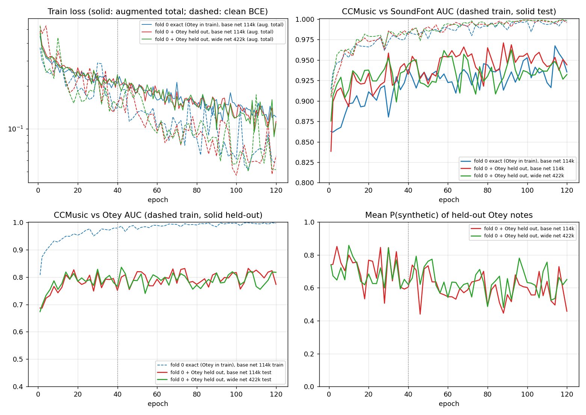

# Is the isolated-note phaseogram CNN undertrained or too small?

Diagnostic for `cnn_iso/` (RESULTS_CNN_ISO.md). CPU only, local. Nothing outside `cnn_iso/diag/` was changed.

Scripts:
- `train_vs_oof_auc.py`: step 1, from the stored jobs.
- `train_curve.py`: one-fold re-training with per-epoch logging.
- `plot_curves.py`, `window_stats.py`.

Outputs: curves in `cnn_curves.png`, raw per-epoch logs in `curve_*.jsonl`. `p_*_ep40/ep120.npz` hold the scores at those epochs. `p_f0_w1_ep1.npz` is left over from a 1-epoch smoke test and can be deleted.

## 1. What the job files contain

`jobs/<variant>/<model>_<cond>_<split>.npz` hold **no weights**. Each file holds:
- `p` = P(synthetic) for every usable file of the variant;
- `rows`, `train_rows`, class counts, run time, epochs and torch version.

`p` was produced by the final (epoch-40) model through `realness_net._predict` (eval mode, no augmentation, dropout off). So the training-set AUC can be read straight from the stored scores without re-training.

Fold structure that matters for interpretation (constrained f0, T2):

- Folds are grouped by source. Every test fold holds SoundFonts that are absent from training. Out-of-fold AUC therefore measures **generalisation to an unseen generator**, not to unseen notes of a known one.
- **Otey (120 notes, one group) sits entirely in fold 2, and fold 2 holds no CCMusic.** The reported Otey AUC (0.776) compares two sets of scores:
  - Otey scores come from the fold-2 model, which has never seen Otey (mean P = 0.50);
  - CCMusic scores come from the other four fold models.

## 2. Training AUC vs out-of-fold AUC (stored epoch-40 fits, 5 folds)

| model | CCMusic vs | train AUC, mean (min-max over folds) | within-fold test AUC, mean (min-max) | pooled OOF AUC (paper table) |
|---|---|---|---|---|
| CNN only | SoundFont | 0.984 (0.973-0.992) | 0.924 (0.873-0.957), 4 folds | 0.910 |
| CNN only | Otey | 0.983 (0.976-0.991), 4 folds | -- (Otey held out only in fold 2, which has no real notes) | 0.776 |
| Fusion-47 | SoundFont | 1.000 (0.99994-1.000) | 0.963 (0.928-0.987), 4 folds | 0.940 |
| Fusion-47 | Otey | 1.000 (0.9997-1.000), 4 folds | -- | 0.817 |

Per-fold numbers are in `train_vs_oof_auc.csv`.
- The fusion model separates its training set perfectly.
- The CNN-only model reaches 0.98 at epoch 40. It does not reach 1.0 because of the augmentation, dropout and weight decay.

## 3. Learning curves, one fold, 120 epochs (same code, same seeds)

`train_curve.py` repeats `realness_net._train_fold` line by line: same model, augmentation, loss, Adam 1e-3, weight decay 1e-4, batch 24 and seed 0. It keeps training at a constant learning rate to 120 epochs. Every 2 epochs it scores the clean training rows and the held-out rows.

Reproduction check (epoch 40 of run A vs the stored `constr/cnn_T2_f0.npz`):
- Spearman 0.989 over 1550 files, mean |dP| 0.037. The remaining difference comes from CPU thread-count nondeterminism.
- Train AUC: SF 0.984 vs 0.983 stored, Otey 0.979 vs 0.976.
- Test SF: 0.939 vs 0.935.

Runs:
- **A**: exactly fold 0 (Otey in training), base net (114k CNN parameters, 147k total), 1218 training files.
- **B**: fold 0 with the Otey group also removed from training (1098 training files). Otey is then a held-out generator, scored against the fold-0 CCMusic test notes **by the same model**.
- **C**: as B, with a wide CNN (channels 32-64-128-256; 422k CNN parameters, 455k total, 3.7x the base net).

Averages over the evaluation points in each epoch window. Values are mean ± SD across epochs; the SD shows how much a single-epoch number wanders.

| run | epochs | train AUC SF | test AUC SF (fold-0 SoundFonts: Casio CA-110, Yamaha PSR-400) | test AUC Otey (unseen) | clean train BCE |
|---|---|---|---|---|---|
| A base, exact f0 | 30-40 | 0.977 ± 0.004 | 0.915 ± 0.020 | -- | 0.200 |
| A | 50-70 | 0.987 ± 0.005 | 0.928 ± 0.008 | -- | 0.118 |
| A | 80-120 | 0.994 ± 0.004 | 0.937 ± 0.014 | -- | 0.082 |
| B base, Otey out | 30-40 | 0.982 ± 0.003 | 0.937 ± 0.015 | 0.785 ± 0.024 | 0.180 |
| B | 50-70 | 0.991 ± 0.004 | 0.949 ± 0.014 | 0.795 ± 0.022 | 0.107 |
| B | 80-120 | 0.996 ± 0.002 | 0.951 ± 0.010 | 0.799 ± 0.022 | 0.075 |
| C wide, Otey out | 30-40 | 0.983 ± 0.002 | 0.933 ± 0.018 | 0.791 ± 0.023 | 0.170 |
| C | 50-70 | 0.991 ± 0.004 | 0.939 ± 0.018 | 0.790 ± 0.021 | 0.116 |
| C | 80-120 | 0.997 ± 0.002 | 0.935 ± 0.011 | 0.790 ± 0.022 | 0.081 |

Observations:

1. **Training loss keeps falling, and train AUC reaches 0.995-0.997 by 80-120 epochs.**
   - At 40 epochs the net is slightly under-converged on its training set: train AUC 0.98 and clean BCE still falling.
   - This does not limit the test result: train AUC is well above test AUC from about epoch 10 onwards.
2. **Longer training gives at most +0.01 to +0.02 test AUC.**
   - SoundFont: 0.915 → 0.937 (A), 0.937 → 0.951 (B). Otey: 0.785 → 0.799.
   - These gains are about the size of the epoch-to-epoch wander (SD 0.01-0.02).
   - The fold-0 test set has only two SoundFonts and 176 CCMusic notes, so its bootstrap uncertainty is larger still.
   - Test AUC levels off after about 50-60 epochs while training loss keeps falling.
3. **Held-out Otey stays at 0.79-0.80 AUC from epoch about 15 to 120, in both nets.**
   - Its mean P(synthetic) drifts *down*: 0.75-0.85 early, about 0.5-0.65 late.
   - Extra training fits the known generators more tightly but does not carry over to the unseen one.
4. **The 3.7x wider net gives no gain.**
   - Its training curve is the same as the base net's.
   - Test SF 0.935 vs 0.951 for the base net (lower, within noise); test Otey 0.790 vs 0.799.
5. **The gap between train and test is large and does not close:** train 0.99+ vs unseen SoundFonts 0.93-0.95 vs unseen Otey 0.79 (and library notes 0.71 in the paper table, also an unseen-source condition).
   - This is a generalisation-limited problem.
   - What limits it is the number of distinct sound sources: 10 SoundFonts, one physical model and 6 CCMusic pianos.
   - The number of notes, the length of training and the size of the network are not the limit.

## 4. Verdict

- **Not underfitting:** train AUC is 0.98 at epoch 40 and 0.995+ at 120; fusion-47 reaches 1.000.
- **Not capacity-limited:** the 3.7x wider CNN matches the base net on unseen SoundFonts and on unseen Otey.
- **Data-limited (fits the training generators, does not transfer to new ones):**
  - The train/test gap is 0.05-0.07 for unseen SoundFonts and about 0.2 for the unseen physical model. More epochs do not reduce it.
  - Training to 120 epochs gives at most about +0.01 to 0.02 test AUC, within the epoch-to-epoch noise.

**Recommendation.** A bigger or longer GPU training is not worthwhile for the revision.
- The expected change (+0.01-0.02 at best) is smaller than the bootstrap CIs (about ±0.07). It would not change the conclusion "CNN ≈ XGBoost on isolated notes".
- What could move the numbers is a wider variety of sound sources:
  - more distinct synthetic generators: other physical/modal models, more SoundFonts and sample engines;
  - more distinct real pianos and recording chains;
  - evaluation per held-out generator.

Suggested wording for the paper: "training AUC reaches 0.98 (CNN) and 1.00 (fusion) on the training folds; a 120-epoch run and a 3.7x wider network did not raise held-out AUC beyond epoch-to-epoch variation (±0.02); the limitation is the number of distinct sound sources, not model capacity or training length."
